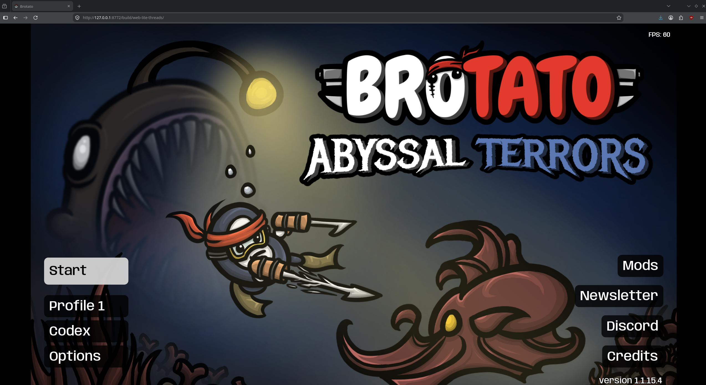

## brotato web port



see [godot web port template](https://github.com/degloved-net/godot-web-port-template) for how to build

## mods

point the script to your mod zip, then rebuild

```bash
sh scripts/add-mod.sh
sh scripts/build.sh
```

 _some mods may need changes for the web or your game version

